# Lab 6: Planetas y estrellas con shaders

Tres cuerpos celestes de un sistema solar de fantasía, dibujados con un software
renderer en CPU, más la luna de la jungla. Todos usan la misma `sphere.obj`, sin
modificar sus vértices y sin texturas: toda la apariencia sale de fragment shaders
procedurales.

| Jungla (rocoso) | Mundo tóxico (gaseoso) | Sol rojo (estrella) |
|---|---|---|
| 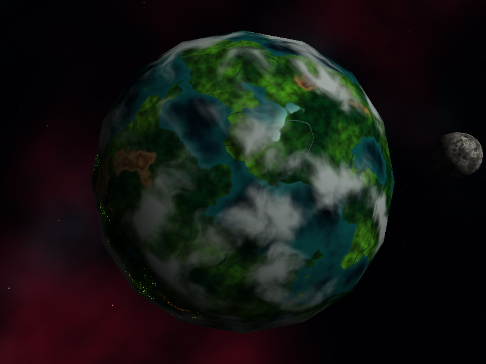 | 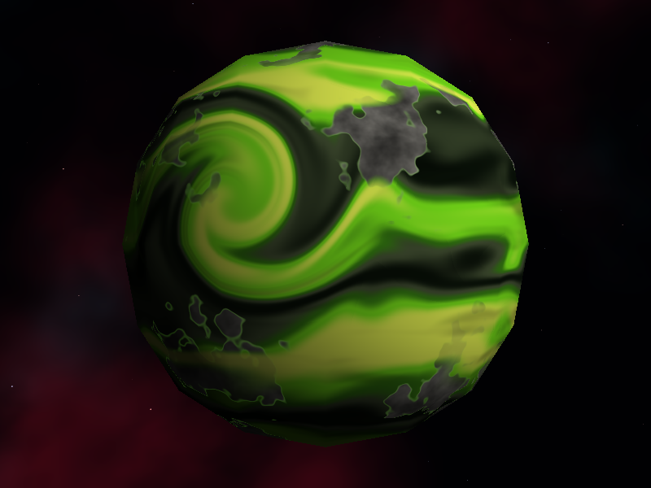 | 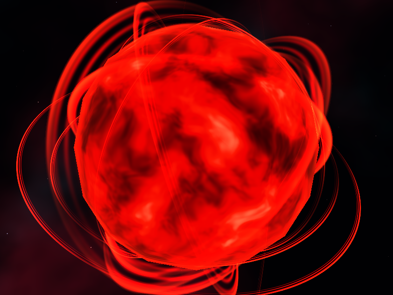 |

## Cómo se ejecuta

Requiere Rust. `raylib` se compila desde su código fuente, así que además necesita
CMake, un compilador de C y las bibliotecas de desarrollo de OpenGL y del sistema de
ventanas.

```bash
cargo run --release        # desde la raíz del repositorio: sphere.obj se carga de ahí
cargo test                 # pruebas del renderer y de los shaders
```

### Controles

| Tecla | Acción |
|---|---|
| `1` | Jungla |
| `2` | Mundo tóxico |
| `3` | Sol rojo |
| Flechas | Orbitar la cámara |
| Rueda del mouse | Acercar o alejar |
| `Inicio` | Reiniciar la cámara |

Para ver el lado oscuro de los planetas, orbita con las flechas.

### Otras opciones

```bash
cargo run --release -- --benchmark       # mide los milisegundos por cuadro de cada cuerpo
cargo run --release -- --export-images   # guarda las capturas en docs/
cargo run --release -- --export-clips    # guarda los cuadros de los clips en docs/frames/
scripts/make_gifs.sh                     # convierte esos cuadros en GIF (requiere ffmpeg)
```

Las constantes que controlan cada apariencia están al inicio de cada archivo de
`src/shaders/` y de `src/rings.rs`. Para probar otro valor, se edita la constante y se
vuelve a ejecutar.

## Los cuerpos celestes

### Jungla

Un planeta salvaje cubierto de selva, con ríos, mesetas de roca y cielo tormentoso. De
noche se llena de luciérnagas y de las fogatas de asentamientos de simios.

Archivo: `src/shaders/jungle.rs`.

**Patrones y cómo se combinan**

1. Una sola altura, calculada con `fbm` (varias octavas de OpenSimplex), decide dónde
   hay mar, selva o roca al compararla con dos umbrales.
2. En el mar, la altura también aclara el agua cerca de la costa.
3. En la selva, un ruido de humedad elige el tono de verde y un ruido de alta frecuencia
   agrega el grano de las copas. Los ríos aparecen donde otro ruido cruza por cero, porque
   esas zonas forman líneas continuas.
4. En la roca, un seno de la altura dibuja franjas como estratos.
5. Encima van las sombras, luego las nubes, y al final la luz, el reflejo y las luces de
   la noche.

**Parámetros principales**

| Constante | Valor | Qué cambia |
|---|---:|---|
| `CONTINENT_SCALE` | 2.3 | Más alto da masas de tierra más pequeñas y numerosas |
| `SEA_LEVEL` | 0.495 | Más alto deja menos tierra |
| `HIGHLAND_LEVEL` | 0.62 | Más alto deja menos roca |
| `CANOPY_SCALE` | 26 | Tamaño de las copas de los árboles |
| `RIVER_WIDTH` | 0.012 | Grosor de los ríos |

### Mundo tóxico

Un gigante gaseoso envenenado: lo que fue un mundo habitado después de una guerra
nuclear. Sus bandas de lodo, ceniza y verde ácido fluyen como líquido, con trozos de
cemento de la antigua civilización flotando en el gas. En el lado oscuro, ondas tóxicas
surgen de la nada y son la única luz.

Archivo: `src/shaders/toxic.rs`.

**Patrones y cómo se combinan**

1. Las bandas son un seno de la latitud, más otro más fino encima.
2. Para que las transiciones parezcan líquido, una capa de ruido distorsiona a otra y el
   resultado desplaza el seno (`flow`).
3. Una rampa de cinco colores convierte ese valor en lodo, ceniza, musgo, verde ácido y
   amarillo. Unas vetas estiradas de ruido apagan parte de las bandas.
4. La tormenta gira las coordenadas antes de calcular las bandas, así que curva el
   patrón existente en vez de dibujarse encima.
5. Los restos de cemento salen de otro ruido, con bordes rotos por uno más fino. No se
   mueven, mientras que las bandas más densas les pasan por encima.
6. Las ondas se suman como luz propia, solo en el lado oscuro.

**Parámetros principales**

| Constante | Valor | Qué cambia |
|---|---:|---|
| `BAND_FREQUENCY` | 11 | Más alto da bandas más angostas |
| `TURBULENCE` | 11 | Ondulación de los bordes: 0 los deja rectos |
| `FLOW_SPEED` | 0.05 | Velocidad de la atmósfera |
| `ASH_AMOUNT` | 0.35 | Cuánto oscurecen las vetas de ceniza |
| `RUIN_THRESHOLD` | 0.55 | Más alto deja menos restos de cemento |
| `RIPPLE_COUNT` | 14 | Cantidad de focos de ondas |
| `RIPPLE_LIGHT` | 1.5 | Fuerza de la luz verde de las ondas |

Tiene piezas sólidas, pero sigue siendo un gigante gaseoso: son escombros en la
atmósfera y no una superficie.

### Sol rojo

Una estrella de plasma rojo, con manchas oscuras y un contorno brillante, rodeada de
anillos de energía que nacen en su interior y se expanden hasta apagarse.

Archivos: `src/shaders/sun.rs` y `src/rings.rs`.

**Patrones y cómo se combinan**

1. Tres ruidos que se mueven forman un vector que distorsiona al ruido principal
   (`heat`). Por eso el plasma se deforma en vez de deslizarse.
2. Un ruido más lento marca las manchas, que restan calor.
3. Una rampa convierte el calor en color: rojo casi negro, rojo puro, rojo encendido y
   rosado en las zonas más calientes.
4. No usa la luz externa. Solo el contorno depende de la cámara: brilla más donde la
   superficie queda de canto.

**Anillos.** No agregan geometría. Después de sombrear la esfera, para cada píxel se
calcula dónde cruza el rayo de la cámara el plano de cada anillo y a qué distancia del
centro queda ese punto. El sol tapa los anillos que están detrás. Hay dos grupos: 7
gruesos y cercanos, y 5 delgados que llegan más lejos.

**Parámetros principales**

| Constante | Archivo | Valor | Qué cambia |
|---|---|---:|---|
| `FLOW_SPEED` | `sun.rs` | 0.14 | Velocidad con la que hierve el plasma |
| `TURBULENCE` | `sun.rs` | 2.6 | Cuánto se retuerce el plasma |
| `SPOT_THRESHOLD` | `sun.rs` | 0.60 | Más alto da menos manchas |
| `SPOT_DARKNESS` | `sun.rs` | 0.8 | Oscuridad de las manchas |
| `RING_COUNT` | `rings.rs` | 7 | Cantidad de anillos gruesos |
| `THIN_RING_COUNT` | `rings.rs` | 5 | Cantidad de anillos delgados |
| `RING_BRIGHTNESS` | `rings.rs` | 2.3 | Brillo de todos los anillos |

### Luna de la jungla

Una luna gris de roca con mares oscuros y cráteres, que orbita alrededor de la jungla.

Archivos: `src/shaders/moon.rs` y `moon_model` en `src/main.rs`.

No agrega ningún modelo: es la misma `sphere.obj`, dibujada una segunda vez con otra matriz
que la escala y la traslada. El búfer de profundidad decide si pasa por delante del planeta
o queda oculta detrás. Siempre le muestra la misma cara a la jungla.

**Patrones y cómo se combinan**

1. `fbm` da el tono de la roca, y un ruido de baja frecuencia oscurece los mares.
2. Los cráteres (`craters`) se reparten en una cuadrícula con posición y tamaño al azar.
   Oscurecen el fondo y aclaran el borde. Hay dos escalas superpuestas.
3. Recibe la misma luz que el planeta.

**Parámetros principales**

| Constante | Archivo | Valor | Qué cambia |
|---|---|---:|---|
| `MOON_SCALE` | `main.rs` | 0.14 | Tamaño de la luna |
| `MOON_ORBIT_RADIUS` | `main.rs` | 1.15 | Distancia a la jungla |
| `MOON_ORBIT_SPEED` | `main.rs` | 0.25 | Velocidad de la órbita |
| `MOON_ORBIT_TILT` | `main.rs` | 0.35 | Inclinación de la órbita |
| `LARGE_CRATER_GRID` | `moon.rs` | 4 | Más alto da cráteres grandes más pequeños y numerosos |
| `CRATER_CHANCE` | `moon.rs` | 0.55 | Fracción de celdas con cráter |

## Efectos implementados

Los clips con tiempo acelerado lo indican. Los demás van a velocidad real.

### Nubes procedurales (10 puntos)

- **Cuerpo:** Jungla.
- **Implementación:** `src/shaders/jungle.rs`, `cloud_density`.
- **Funcionamiento:** una máscara de `fbm`, distorsionada por otra capa de ruido, se
  mezcla con la superficie. Gira alrededor del eje `y` mientras el terreno queda fijo. No
  agrega otra esfera.
- **Parámetro:** `CLOUD_COVERAGE` (0.42). Con 0 el cielo queda despejado, y cerca de 1
  queda casi cubierto, porque baja el umbral del ruido.

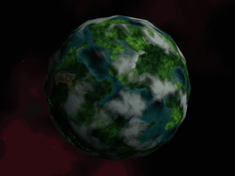

### Sombras de nubes (20 puntos)

- **Cuerpo:** Jungla.
- **Implementación:** `src/shaders/jungle.rs`, `point_towards_light` y `shade`.
- **Funcionamiento:** desde cada punto del suelo se sale hacia la luz hasta la capa de
  nubes, una esfera de radio `1 + CLOUD_ALTITUDE`. Allí se evalúa la misma
  `cloud_density` que dibuja las nubes y, según su valor, se oscurece el suelo. Por eso la
  sombra tiene la forma de su nube, se mueve con ella y cambia con la dirección de la luz.
- **Parámetro:** `CLOUD_ALTITUDE` (0.07). Al subirlo, la sombra se separa más de su nube.
  `SHADOW_STRENGTH` (0.72) controla cuánto oscurece.
- **Video:** en este clip las nubes están quietas y solo se mueve la luz.

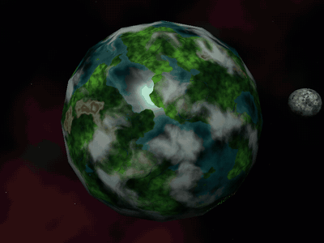

### Respuestas diferentes a la iluminación (10 puntos)

- **Cuerpo:** Jungla.
- **Implementación:** `src/shaders/jungle.rs`, `specular` y `shade`.
- **Funcionamiento:** una máscara marca el agua, y solo ahí se suma un reflejo especular
  (Blinn-Phong) que depende de la cámara. La selva y la roca solo reciben luz difusa, así
  que son mates. Las nubes tapan el reflejo y sus sombras lo apagan.
- **Parámetro:** `WATER_SHININESS` (70). Más alto da un brillo más pequeño y concentrado.
  `WATER_REFLECTION` (0.85) en 0 deja el agua tan mate como la selva.
- **Video:** en este clip solo se mueve la cámara, y el brillo se desplaza sobre el agua.

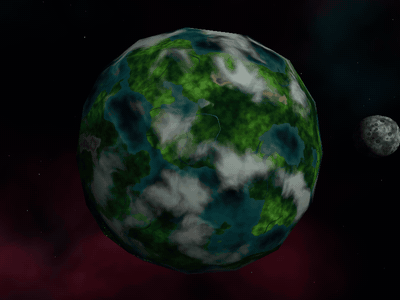

### Apariencia de día y noche (5 puntos)

- **Cuerpo:** Jungla. El mundo tóxico también tiene su propio efecto nocturno.
- **Implementación:** `src/shaders/jungle.rs`, `night_factor`, `fireflies` y `settlements`.
- **Funcionamiento:** a partir de la luz se calcula un factor que vale 0 de día y 1 de
  noche. Las luciérnagas y fogatas se multiplican por él, y solo existen en la selva. Las
  nubes tapan parte de su luz.
- **Parámetro:** `FIREFLY_BRIGHTNESS` (1.5) y `CAMPFIRE_BRIGHTNESS` (1.7) en 0 apagan cada
  tipo de luz. `SETTLEMENT_THRESHOLD` (0.56) más alto deja menos asentamientos.

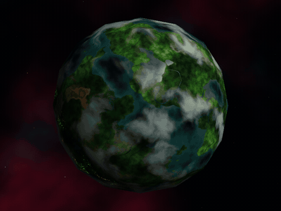

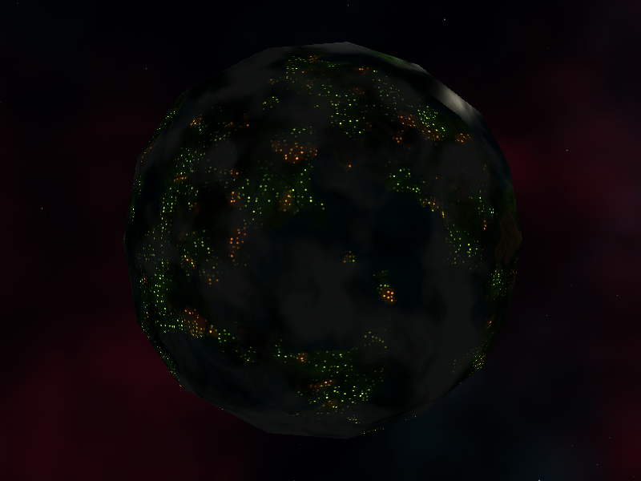

### Tormenta o vórtice (10 puntos)

- **Cuerpo:** Mundo tóxico.
- **Implementación:** `src/shaders/toxic.rs`, `swirl`.
- **Funcionamiento:** antes de calcular las bandas, cada punto se gira alrededor del
  centro de la tormenta. El giro es máximo en el centro y llega a 0 en el borde, así que
  las bandas de afuera se conectan sin cortes con las curvas de adentro.
- **Parámetro:** `STORM_TWIST` (5.5). Con 0 las bandas quedan rectas, y más alto las
  enrosca más. `STORM_RADIUS` (0.62) cambia el tamaño de la zona afectada.

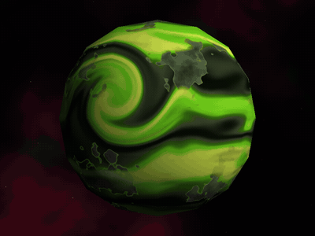

### Material animado (5 puntos)

- **Cuerpo:** Sol rojo.
- **Implementación:** `src/shaders/sun.rs`, `heat`.
- **Funcionamiento:** el tiempo desplaza los ruidos que forman el plasma, así que la
  superficie cambia de forma mientras la geometría sigue inmóvil. Es un movimiento aparte
  del de las nubes.
- **Parámetro:** `FLOW_SPEED` (0.14). Más alto hace que el plasma hierva más rápido.

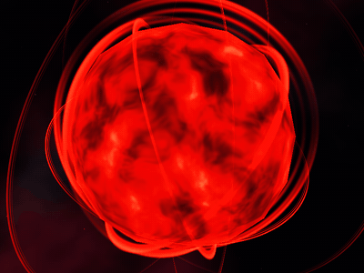

### Efectos que no están implementados

No se solicitan puntos por relieve con bump mapping ni por parallax.

## Diseño adicional

Esto forma parte del diseño, pero no se solicitan puntos del menú por ello.

**Ondas tóxicas del lado oscuro** (`src/shaders/toxic.rs`, `ripple`). Hay focos repartidos
al azar, cada uno con su ritmo, que pasan parte del ciclo apagados. Sus frentes avanzan
deformados por ruido e iluminan de verde el gas y el cemento cercanos. `RIPPLE_LIGHT`
controla la fuerza de esa luz.

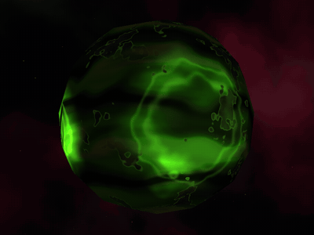

**Anillos del sol** (`src/rings.rs`). Se describen en la sección del sol. Se calculan por
píxel sobre el resultado, fuera de la silueta de la esfera, por lo que no son parte del
fragment shader de la estrella.

**Fondo** (`src/background.rs`). Nebulosas oscuras y estrellas generadas con ruido. Se
mueve según la dirección de la cámara, y por eso parece estar lejos.

## Renderer

`src/main.rs` sigue el pipeline visto en clase: vertex shader, rasterización con coordenadas
baricéntricas y prueba de profundidad, seguida del fragment shader.

- **Normales:** las de `sphere.obj` son planas, una por cara. `src/obj.rs` promedia las
  caras que comparten una posición para repartir la luz suavemente. Las posiciones no se
  tocan, por lo que la silueta conserva las caras de la esfera.
- **Interpolación:** usa corrección de perspectiva, para que los patrones no se deformen.
- **Paralelismo:** los fragmentos se sombrean en paralelo con `rayon`, porque el ruido es
  costoso.
